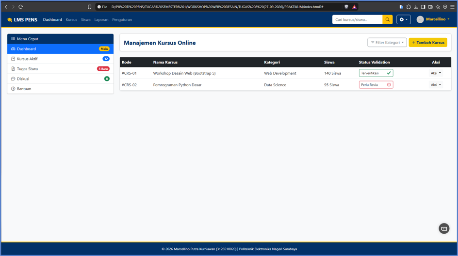

# Dashboard Admin LMS Kursus Online | Bootstrap 5 Advanced Components

Sebuah proyek halaman web _Dashboard Admin LMS (Learning Management System)_ interaktif dan responsif yang dikembangkan sebagai tugas praktikum **Modul 08: Bootstrap ke-03** pada mata kuliah **Workshop Desain Web**. Proyek ini mendemonstrasikan pengintegrasian komponen _user interface_ (UI) Bootstrap 5 tingkat lanjut seperti _Navigation Bar, Sidebar List Groups, Dropdown Components, Form Controls, Form Inputs,_ serta _Validation States_.

---

## 🚀 Fitur Utama & Kriteria Bootstrap

- **Navigation Bar Responsif:** Memuat _brand/logo_ PENS, menu utama (_Dashboard, Kursus, Siswa, Laporan, Pengaturan_), formulir pencarian cepat, _dropdown_ pengaturan cepat berisikan _form switch_, serta _dropdown_ profil admin[cite: 105].
- **Sidebar dengan List Groups:** Pintasan menu navigasi samping (_Dashboard, Kursus Aktif, Tugas Siswa, Diskusi, Bantuan_) berikon yang dilengkapi lencana (_badge_) notifikasi interaktif[cite: 105].
- **Dropdown Components Multi-fungsi:** Menyediakan _dropdown_ filter kategori data, _dropdown_ aksi per item pada tabel (_Lihat Detail, Edit, Hapus_), serta _dropdown_ formulir pengaturan cepat di _navbar_[cite: 105].
- **Forms & Modal Interaktif:** Dilengkapi formulir modal untuk penambahan kursus baru serta pembaruan profil administrator[cite: 105].
- **Variasi Form Inputs:** Menggunakan berbagai jenis masukan masif seperti _text input, email, select, textarea, file upload, range slider, checkbox, radio button,_ serta _input-group_ berikon[cite: 105].
- **Validation States:** Mengimplementasikan indikator status validasi visual (`.is-valid` dan `.is-invalid`) beserta pesan umpan balik (`.valid-feedback` dan `.invalid-feedback`)[cite: 103, 105].
- **Flexbox Sticky Footer:** Penerapan tata letak Flexbox kustom agar elemen _footer_ selalu berada di posisi paling bawah halaman secara presisi.
- **Identitas Warna Kustom:** Mengintegrasikan skema warna identitas kampus khusus, yaitu `#023269` (Biru Utama) dan `#f3c907` (Kuning Emas) pada komponen Bootstrap.

---

## 🛠️ Teknologi yang Digunakan

- **HTML5** (Struktur Dokumen Semantik)
- **CSS3** (Variabel Kustom, Flexbox Sticky Footer, & Styling Warna Kampus)
- **Bootstrap 5** (Navbar, List Groups, Dropdowns, Forms, Inputs, Modals, Components CDN)[cite: 88, 90, 92, 95, 100]
- **Bootstrap Icons** (Ikonografi Antarmuka)
- **JavaScript ES6 / Bootstrap Bundle** (Interaktivitas Modal, Dropdown, & Toggle Navbar)[cite: 91, 94, 98, 103]

---

## 📂 Section Halaman yang Disediakan

1. **Header & Navigation Bar:** Bilah navigasi terpadu dengan pencarian dan menu profil pengguna[cite: 105].
2. **Sidebar Menu Cepat (List Groups):** Navigasi ringkas dengan indikator _badge_ notifikasi[cite: 105].
3. **Manajemen Kursus Online (Table & Dropdown Actions):** Tabel data kursus interaktif dengan menu aksi melayang dan status validasi[cite: 105].
4. **Form Modal Tambah Kursus:** Formulir pop-up komprehensif berisikan berbagai jenis _input controls_[cite: 105].
5. **Form Modal Edit Profil:** Formulir cepat untuk memperbarui data identitas admin[cite: 105].
6. **Footer:** Hak cipta dan rincian modul praktikum.

---

## 📸 Tangkapan Layar (Pratinjau Tampilan)

### Tampilan

---

## 👨‍💻 Penulis

**Marcellino Putra Kurniawan**

- **NRP:** 3126510020[cite: 88]
- **Program Studi:** D3 PJJ Teknik Informatika '26[cite: 88]
- **Institusi:** Politeknik Elektronika Negeri Surabaya[cite: 88]

---

_Dibuat untuk memenuhi Tugas Praktikum 8 Workshop Desain Web (Semester 1)._[cite: 88]
